<div align="center">

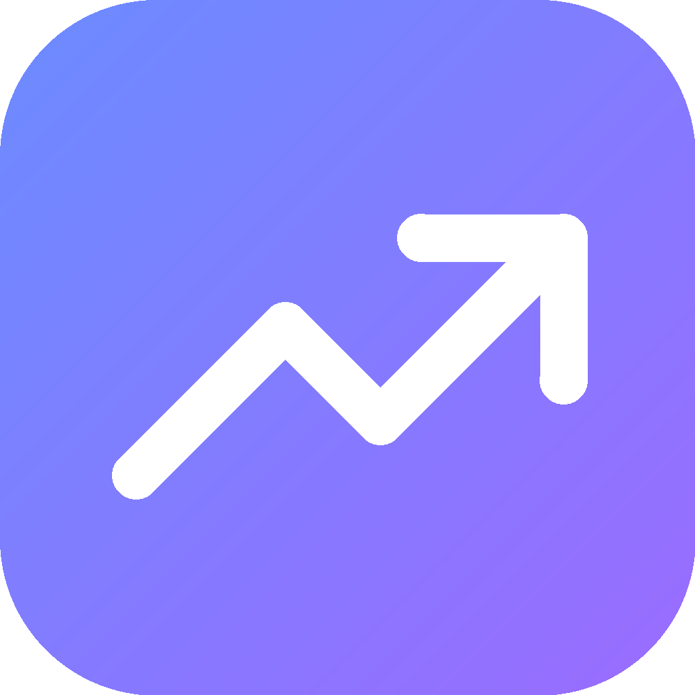

# Tradebot

**Sentiment-driven MT5 auto-trading for Android**: fingerprint-locked, risk-managed and themeable.

[](../../actions/workflows/build-apk.yml)


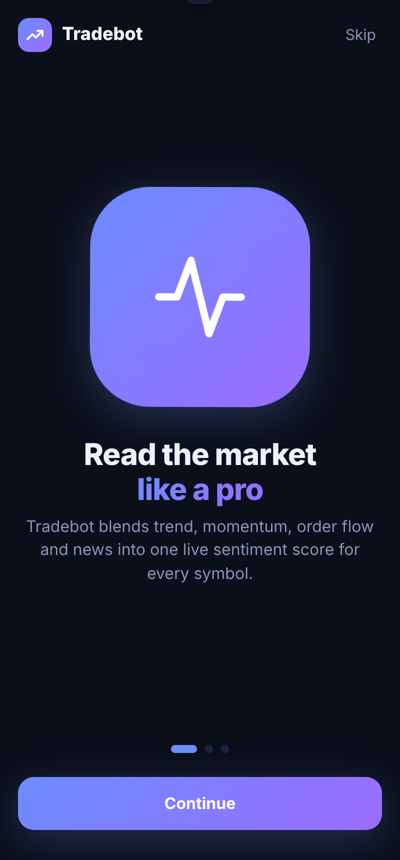 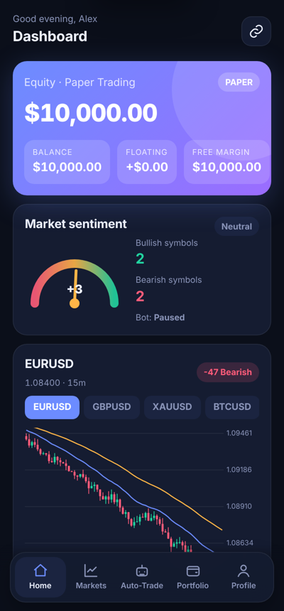 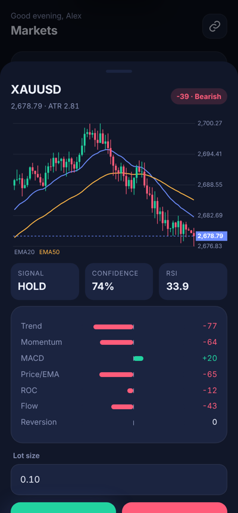 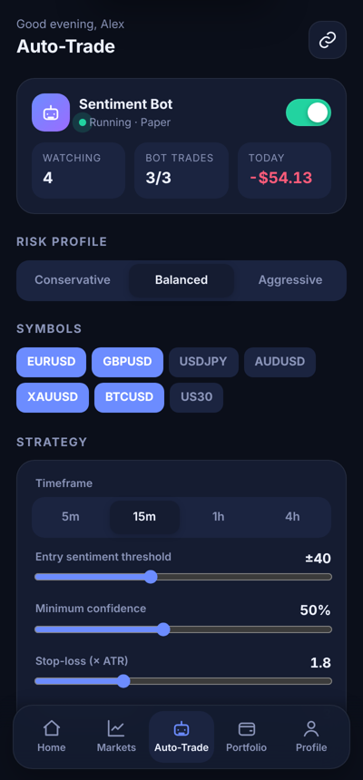

</div>

> [!WARNING]
> Trading leveraged products such as forex, CFDs, gold and crypto carries a high risk of losing money. Tradebot is a tool, not financial advice. Start in **Paper** mode, then use an MT5 **demo** account. Only connect a live account if you understand and accept the risk.

---

## Features

| Area | What you get |
|---|---|
| 👋 **Welcome & onboarding** | Swipeable 3-step intro, then a guided profile setup |
| 🔐 **Fingerprint lock** | Android BiometricPrompt unlock with a 6-digit PIN fallback; the app re-locks after 60 s in the background |
| 🔑 **Secure credentials** | MetaApi token stored in the Android Keystore via the biometric plugin. Your MT5 password is never stored on the phone |
| 🔗 **MT5 account setup** | Two ways: **Own VPS bridge** (free, runs next to MT5 on your Windows PC/VPS using MetaQuotes' official Python package, see [docs/VPS_BRIDGE.md](docs/VPS_BRIDGE.md)) or [MetaApi](https://metaapi.cloud) (paid cloud, no PC needed) |
| 📈 **Market sentiment** | Per-symbol score from −100 to +100 built from 7 technical factors plus optional news sentiment, with a confidence rating and a market-mood gauge |
| ✨ **Auto strategy** | Detects each symbol's regime and picks Trend, Breakout, Reversion or Sentiment logic, sized by the overall market mood. A live *strategy radar* shows each decision |
| 💵 **Fixed $ targets** | Take-profit and stop-loss in dollars per trade (e.g. +$3 / −$3) with automatic lot sizing, plus basket targets that close all bot trades at a combined profit or loss |
| ⛔ **Close all** | One tap to close every position, or only bot trades, winners or losers, optionally stopping the bot too |
| 🤖 **Auto-trading** | Opens trades on strong, high-confidence signals with ATR-based stop-loss and take-profit, risk-based position sizing, a max-positions cap, exit on sentiment flip, and a **daily loss limit kill-switch** |
| 💼 **Portfolio** | Equity, balance, floating P/L, open positions (one-tap close), allocation donut, equity curve, win rate, average win and loss, closed-trade history |
| 👤 **Profile** | Name, avatar colour, investor risk profile (Conservative, Balanced or Aggressive), PIN change, biometric toggle, data wipe |
| 🎨 **Themes & rich UI** | Follows the phone's light/dark mode (System), or force Light/Dark; adjustable dashboard card opacity; live trade cards with SL→TP progress; candlestick charts with EMA overlays; animated gauges; glass navigation; haptic-style micro-animations |
| 🧪 **Paper mode** | A built-in simulated market with $10k virtual cash, so you can try everything with no account and no risk |
| 🔔 **Notifications** | Local notifications when the bot trades or pauses |

## Screenshots

| Setup | Dashboard (Light) | Markets detail | Portfolio | Profile (Aurora) | MT5 connect | Lock |
|---|---|---|---|---|---|---|
| 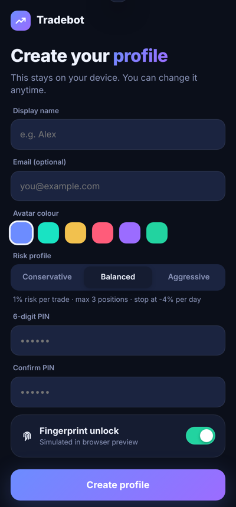 | 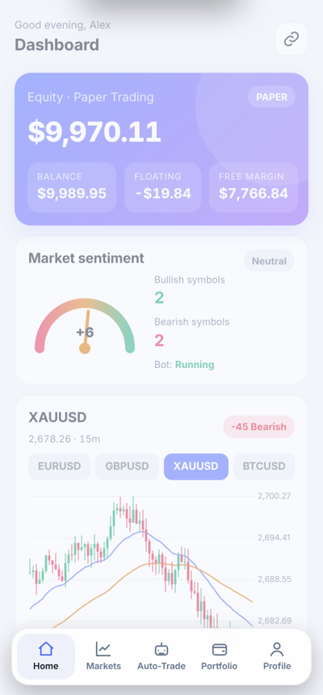 |  | 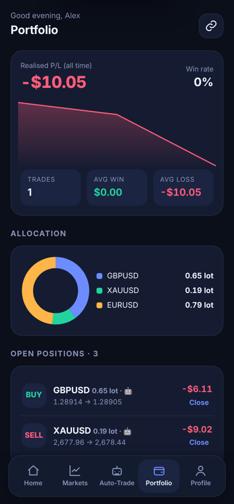 | 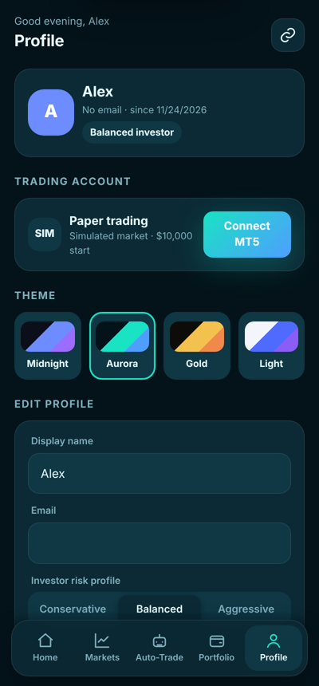 | 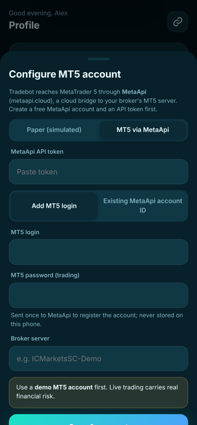 | 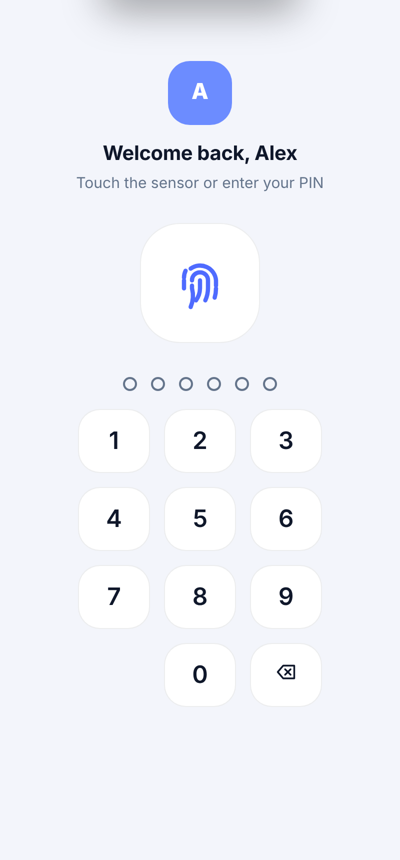 |

## Get the APK

**Direct download:** [Tradebot.apk](../../raw/apk/Tradebot.apk) (latest build of `main`, kept on the `apk` branch).

**Option A: GitHub Actions (no tools needed)**
1. Every push to `main` runs **Build Android APK**. Open the **Actions** tab, pick the latest run, and download the **Tradebot-apk** artifact (`Tradebot-debug.apk`).
2. Push a tag such as `v1.0.0` to also publish the APK on the **Releases** page.
3. On your phone, allow *Install unknown apps* for your browser or file manager, then open the APK.

**Option B: Build locally.** See [docs/BUILDING.md](docs/BUILDING.md).

```bash
npm install
npm run android:init      # generates android/, icons, permissions
npm run apk:debug         # → android/app/build/outputs/apk/debug/app-debug.apk
```

**Preview the UI in a browser:** run `npm run serve` and open http://localhost:8080. Fingerprint is simulated in the browser.

## Connect your MT5 account

**Option 1: Own VPS bridge (free).** Install MT5 on a Windows PC or VPS, run one PowerShell command, then enter the Bridge URL and Access key under **Profile → Connect MT5 → Own VPS**. Full guide: [docs/VPS_BRIDGE.md](docs/VPS_BRIDGE.md).

**Option 2: MetaApi (paid cloud).**

Short version (full guide in [docs/MT5_SETUP.md](docs/MT5_SETUP.md)):
1. Create a free account at **metaapi.cloud** and generate an **API token**.
2. In Tradebot, go to **Profile → Connect MT5** (or tap the link icon at top right) and choose **MT5 via MetaApi**.
3. Paste the token, then enter your MT5 **login**, **password** and **broker server** (exactly as shown in MT5, e.g. `ICMarketsSC-Demo`).
4. Tradebot registers and deploys the account, waits until it is connected to your broker, and then shows your live balance and positions.

## How the bot decides

```
candles (200 × timeframe) ─▶ indicators ─▶ 7 weighted factors (+ news) ─▶ score −100…+100 + confidence
                                                                   │
            score ≥ +threshold & confidence ≥ min ─▶ BUY   ◀───────┤
            score ≤ −threshold & confidence ≥ min ─▶ SELL  ◀───────┘
lot = (equity × risk%) ÷ (ATR × SL-multiple × contract size), capped by max lot & broker limits
```

The weights, factors and every safety rule are documented in [docs/STRATEGY.md](docs/STRATEGY.md).

## Project structure

```
tradebot/
├── www/                      # The app (plain HTML/CSS/JS, no bundler)
│   ├── index.html
│   ├── css/app.css           # Design system + 4 themes
│   └── js/
│       ├── app.js            # Screens, state, charts, auto-trader loop
│       ├── engine.js         # Indicators + sentiment scoring
│       ├── broker.js         # DemoBroker (paper) + MetaApiBroker (MT5) + news sentiment
│       └── security.js       # Fingerprint, PIN hashing, Keystore secrets
├── bridge/                   # Own VPS bridge: bridge.py (FastAPI + MetaTrader5), install.ps1
├── assets/                   # Icon & splash sources (→ @capacitor/assets)
├── scripts/patch-android.mjs # Adds permissions, version, portrait lock
├── capacitor.config.json
├── .github/workflows/build-apk.yml
└── docs/                     # Architecture, setup, strategy, security, building
```

## Documentation

- [Building the APK](docs/BUILDING.md): local builds, signing, CI secrets
- [Own VPS bridge](docs/VPS_BRIDGE.md): free MT5 connection through your own Windows PC or VPS
- [MT5 / MetaApi setup](docs/MT5_SETUP.md): step-by-step account connection and troubleshooting
- [Strategy & risk engine](docs/STRATEGY.md): factors, weights, sizing, kill-switches
- [Architecture](docs/ARCHITECTURE.md): modules, data flow, broker interface
- [Security](docs/SECURITY.md): what is stored where, threat model
- [Changelog](CHANGELOG.md)

## Known limitations

- The bot runs while the app is open (in the foreground, or recently backgrounded). Android may suspend it in the background. For unattended 24/5 trading, run the strategy server-side (a MetaApi-hosted or VPS script) using the same logic.
- MetaApi is a paid third-party service; the free alternative is the Own VPS bridge, which needs a Windows machine running MT5.
- Sentiment is derived mainly from price action. News sentiment (Alpha Vantage) is optional and limited to FX pairs.
- Paper mode runs an accelerated synthetic market (about 18 s per candle) for demonstration. Its results don't predict live performance.

## License

[MIT](LICENSE)
