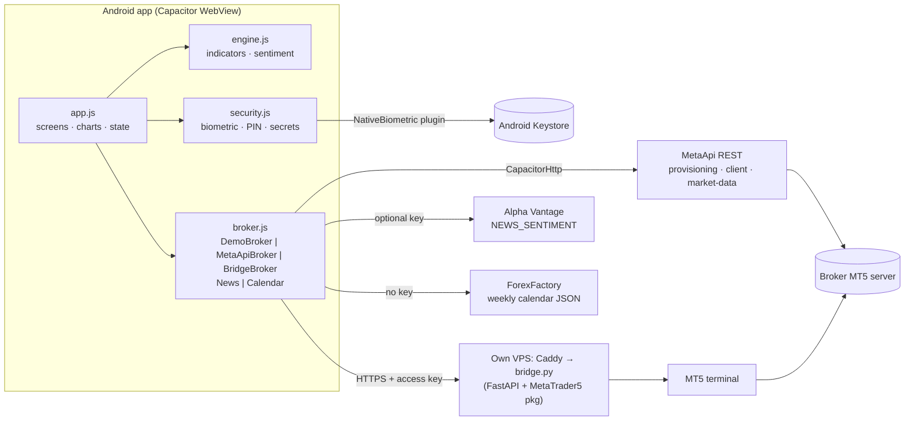
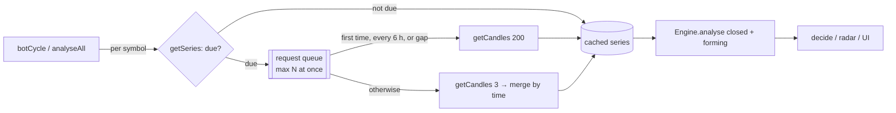
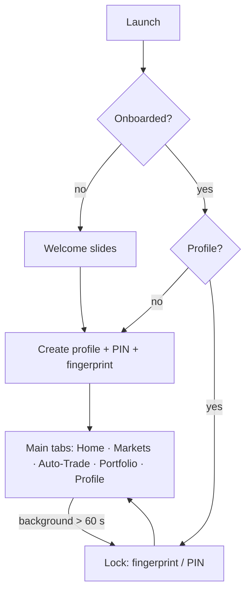

# Architecture



## Modules

| File | Responsibility |
|---|---|
| `www/js/app.js` | App state `S`, the screen router (welcome → setup → lock → main tabs), rendering, canvas charts, polling loop, auto-trader `botCycle()` |
| `www/js/engine.js` | Pure functions: `ema`, `rsi`, `atr`, MACD, Bollinger, `analyse(candles)`, `marketMood()` |
| `www/js/broker.js` | `DemoBroker` (offline simulator with SL/TP execution), `MetaApiBroker` (MetaApi REST), `BridgeBroker` (Own VPS bridge REST), `News` (Alpha Vantage, quota-safe), `Calendar` (ForexFactory economic calendar), `currenciesOf()` |
| `bridge/bridge.py` | Own VPS bridge: FastAPI server over MetaQuotes' `MetaTrader5` package (see [VPS_BRIDGE.md](VPS_BRIDGE.md#bridge-api-for-developers)) |
| `www/js/security.js` | `verify()` biometric prompt, `hashPin()` SHA-256, `setSecret/getSecret` (Keystore on device, localStorage in preview) |
| `www/css/app.css` | Design tokens and 4 themes via `[data-theme]` CSS variables |

## Broker interface

All three brokers implement the same async API, so the UI and bot never branch on the account type:

```ts
connect(onStatus?): Promise<boolean>
getAccount(): Promise<{balance, equity, margin, freeMargin, currency, leverage, name, server}>
getPositions(): Promise<Position[]>          // {id, symbol, type, volume, openPrice, currentPrice, profit, stopLoss, takeProfit, comment}
getHistory(): Promise<Deal[]>
getSymbols(): Promise<string[]>
getSpec(symbol): Promise<{digits, contractSize, minVolume, maxVolume, volumeStep}>
getPrice(symbol): Promise<{bid, ask}>
getCandles(symbol, timeframe, limit): Promise<Candle[]>   // oldest → newest
getCatalog(): Promise<{name, path, description}[]>
trade({symbol, side: 'BUY'|'SELL', volume, stopLoss, takeProfit, comment})
modifyPosition(id, {stopLoss, takeProfit})   // Protect profits; bridge 1.3.0+
closePosition(id, reason)
```

`BridgeBroker` implements this interface against the Own VPS bridge (`bridge/bridge.py`). To add another backend, implement the same interface and add it to `connectBroker()` and the Connect sheet.

### MetaApi endpoints used

| Purpose | Endpoint |
|---|---|
| Register account | `POST mt-provisioning-api-v1…/users/current/accounts` |
| Status / region | `GET  …/users/current/accounts/:id` |
| Deploy | `POST …/users/current/accounts/:id/deploy` |
| Account info | `GET  mt-client-api-v1.{region}…/accounts/:id/account-information` |
| Positions | `GET  …/accounts/:id/positions` |
| Deals history | `GET  …/accounts/:id/history-deals/time/:from/:to` |
| Symbols, spec, price | `GET  …/symbols`, `…/symbols/:s/specification`, `…/symbols/:s/current-price` |
| Candles | `GET  mt-market-data-client-api-v1.{region}…/historical-market-data/symbols/:s/timeframes/:tf/candles` |
| Trade | `POST …/accounts/:id/trade` (`ORDER_TYPE_BUY`, `ORDER_TYPE_SELL`, `POSITION_MODIFY`, `POSITION_CLOSE_ID`) |

## Runtime loops

| Loop | Paper | Own VPS | MetaApi |
|---|---|---|---|
| Account / positions / history poll | 1 s | 1 s | 5 s (MetaApi bills each request against a credit allowance) |
| Protect profits check (bot on) | every poll | every poll | every poll |
| Journal reconcile (open trades only) | every poll | every poll | every poll |
| Bot cycle (bot on) | `intervalSec` (default 10 s) | `intervalSec` | `intervalSec` |
| Analysis refresh (bot off) | 6 s | 60 s | 60 s |
| Candle download per symbol | every scan | when due (see below) | when due (see below) |
| Bigger-trend candles per symbol | 5 min cache | 5 min cache | 5 min cache |
| Economic calendar | 1 h (one request) | 1 h | 1 h |
| News headlines | 90 min (one request, 16/day) | 90 min | 90 min |

## Market data loading and scaling

One bot watches many symbols. Analysis is cheap: each symbol runs `Engine.analyse()` twice on 200 candles, well under 1 ms. The cost that grows with the symbol count is **downloading candles from the broker connection**. That is handled by the loader in `app.js` (`getSeries`, `queued`, `D`).



**Request queue.** At most N broker data requests run at once; the rest wait in order.

| Connection | N | Why |
|---|---|---|
| MetaApi | 4 | MetaApi allows 5 concurrent historical-market-data requests per account; 4 leaves room for the app's other calls |
| Own VPS | 2 | the bridge serves MetaTrader 5 one call at a time; more in flight only queues on the VPS |
| Paper | 64 | local simulator, no limit needed |

**Incremental candles.**
- The full 200 candles are downloaded once per symbol and timeframe, and again every 6 hours to self-heal.
- After that only the last 3 are fetched and merged in by candle time: the forming candle is replaced and new ones are appended, keeping 200.
- If the 3 newest don't overlap the cached ones (the app was asleep while more candles closed), the full series is downloaded instead.

**Due times.**
- Paper refreshes every scan.
- Live accounts refresh a symbol every *timeframe ÷ 15*, clamped to 20 s – 2 min: 5m → 20 s, 15m → 60 s, 1h and 4h → 2 min.
- Each symbol gets its own slot within that window (staggered), so requests trickle instead of bursting.
- The bot still decides once per newly closed candle, so the worst-case extra delay after a candle closes is one refresh window.

**Failures.**
- A failed download keeps the last good series and retries with back-off (5 s × failures, up to 60 s).
- After 3 consecutive failures the symbol is listed on Auto-Trade as "Not updating", and the bot skips it until data returns.
- The status line above the radar reads, for example: "✅ 12 of 12 symbols up to date · last update 4 s ago · refresh every 60 s, up to 4 at a time".

**What does not change:** the candles analysed (same 200, verified identical to a fresh full download), the engine, the decisions, and the once-per-closed-candle rule.

**Measured** with 12 symbols, against a simulated MetaApi connection (300 ms latency, refuses more than 5 concurrent requests):

| | Old (all at once, 200 every scan) | New |
|---|---|---|
| One scan | 5 served, **7 refused, 7 symbols silently skipped** | 4 at a time, none refused |
| 3 minutes of bot scans | ~216 full downloads | **16 full + 15 incremental**, 0 refused |
| Symbols analysed | varies scan to scan | 12 of 12 |
| Merged vs fresh download | — | 198 / 198 closed candles identical, same scores |

**Capacity guidance.**
- **Paper:** any number of symbols.
- **Own VPS:** about 20 watched symbols on 15m. Each refresh is one small request, and two at a time keeps MT5 responsive.
- **MetaApi:** 10–20 watched symbols on 15m or slower. On 5m, keep to about 10, since refreshes come every 20 s.
- **Markets tab:** loads up to 30 visible symbols through the same queue.
- **Open trades:** `maxPositions` caps them whatever the number of symbols.

## App flow



## Persistence

`localStorage` keys prefixed `tb_`: `profile`, `theme`, `prefs`, `onboarded`, `conn`, `bot`, `newsKey`, `log`, `dayStart`, `demo_market`, `posMeta` (per-trade risk and protect state), `posBars`, `journal` (open trades + latest 300 closed), `journalArc` (up to 2,000 compact entries), `journalTotals` (rolled-up totals beyond that), `calendar`, `news`. Candle data is kept in memory only. Secrets go through `security.js` only.
