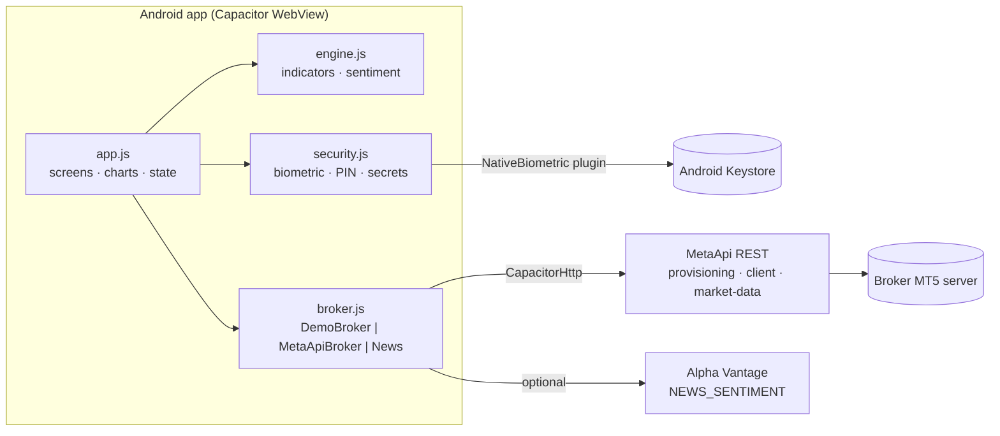
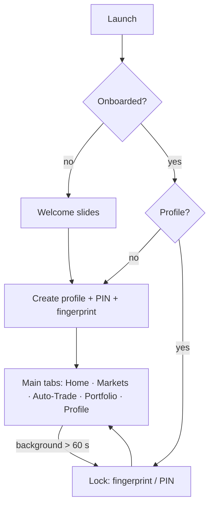

# Architecture



## Modules

| File | Responsibility |
|---|---|
| `www/js/app.js` | App state `S`, the screen router (welcome → setup → lock → main tabs), rendering, canvas charts, polling loop, auto-trader `botCycle()` |
| `www/js/engine.js` | Pure functions: `ema`, `rsi`, `atr`, MACD, Bollinger, `analyse(candles)`, `marketMood()` |
| `www/js/broker.js` | `DemoBroker` (offline simulator with SL/TP execution), `MetaApiBroker` (REST), `News` (Alpha Vantage) |
| `www/js/security.js` | `verify()` biometric prompt, `hashPin()` SHA-256, `setSecret/getSecret` (Keystore on device, localStorage in preview) |
| `www/css/app.css` | Design tokens and 4 themes via `[data-theme]` CSS variables |

## Broker interface

Both brokers implement the same async API, so the UI and bot never branch on the account type:

```ts
connect(onStatus?): Promise<boolean>
getAccount(): Promise<{balance, equity, margin, freeMargin, currency, leverage, name, server}>
getPositions(): Promise<Position[]>          // {id, symbol, type, volume, openPrice, currentPrice, profit, stopLoss, takeProfit, comment}
getHistory(): Promise<Deal[]>
getSymbols(): Promise<string[]>
getSpec(symbol): Promise<{digits, contractSize, minVolume, maxVolume, volumeStep}>
getPrice(symbol): Promise<{bid, ask}>
getCandles(symbol, timeframe, limit): Promise<Candle[]>   // oldest → newest
trade({symbol, side: 'BUY'|'SELL', volume, stopLoss, takeProfit, comment})
closePosition(id)
```

To add another backend (for example a self-hosted Python bridge using the `MetaTrader5` package on a Windows VPS), implement this interface and add it to `connectBroker()`.

### MetaApi endpoints used

| Purpose | Endpoint |
|---|---|
| Register account | `POST mt-provisioning-api-v1…/users/current/accounts` |
| Status / region | `GET  …/users/current/accounts/:id` |
| Deploy | `POST …/users/current/accounts/:id/deploy` |
| Account info | `GET  mt-client-api-v1.{region}…/accounts/:id/account-information` |
| Positions | `GET  …/accounts/:id/positions` |
| Deals history | `GET  …/accounts/:id/history-deals/time/:from/:to` |
| Symbols, spec, price | `GET  …/symbols`, `…/symbols/:s/specification`, `…/symbols/:s/current-price` |
| Candles | `GET  mt-market-data-client-api-v1.{region}…/historical-market-data/symbols/:s/timeframes/:tf/candles` |
| Trade | `POST …/accounts/:id/trade` (`ORDER_TYPE_BUY`, `ORDER_TYPE_SELL`, `POSITION_CLOSE_ID`) |

## Runtime loops

| Loop | Paper | MT5 |
|---|---|---|
| Account/positions poll | 1.5 s | 5 s |
| Analysis refresh (bot off) | 6 s | 60 s |
| Bot cycle (bot on) | `intervalSec` (≥ 5 s) | `intervalSec` (≥ 30 s) |

## App flow



## Persistence

`localStorage` keys prefixed `tb_`: `profile`, `theme`, `onboarded`, `conn`, `bot`, `newsKey`, `log`, `dayStart`, `demo`. Secrets go through `security.js` only.
